---
paths:
  - "wiki/{sources,concepts,frameworks,cases,analyses,questions,inbox,artifacts}/**/*.md"
  - "wiki/attachments/**"
  - "**/*.{mmd,mermaid,puml,plantuml}"
---

# Diagram policy: conventions, verification, selection, hygiene

The track choice and the storage convention stay in `CLAUDE.md` ("Images and diagrams"); this file carries everything downstream of that choice. `CLAUDE.md` points here explicitly, so it applies whether or not the `paths:` header above loaded it automatically. The **syntax** lives in the `diagram-syntax` skill.

## PlantUML conventions

ArchiMate diagrams use the **Hosiaisluoma ArchiMate stdlib** (in the PlantUML standard library), opening with:

```plantuml
@startuml
!include <archimate/Archimate>
title <descriptive title>
skinparam linetype ortho
```



Element macros: `<Layer>_<Element>(id, "label")`, e.g. `Motivation_Goal(g1, "…")`, `Business_Process(bp, "…")`. Relationship macros: `Rel_<Type>(source, target)`, e.g. `Rel_Realization(g2, g1)`. The full per-layer macro tables, the macros that do **not** exist in the stdlib, and worked views live in the `diagram-syntax` skill (`references/archimate-hosiaisluoma.md`); use it rather than guessing macro names. For non-ArchiMate PlantUML (sequence, C4 via `C4-PlantUML`, deployment), include the relevant stdlib and omit the ArchiMate include.

**Output: SVG by default** (scales cleanly, better for labelled ArchiMate). Per-block override with ` ```plantuml-png ` or ` ```plantuml-ascii `.

**Rendering: local JAR** (`wiki/.obsidian/plantuml/plantuml.jar`, GPL, not committed; download once per `wiki/.obsidian/plantuml/README.md`). Fast and offline; prereqs and fallback are in the track list in `CLAUDE.md`.

## Visual verification (Mermaid / PlantUML)

A diagram isn't *done* until confirmed to render: a malformed block shows as an error box only at view time, and a text diff never catches it. So verify every diagram you author or materially edit. **Prefer Method A in a worktree** (the usual case); Method B for interactive work in the live vault.

**Method A: headless render (default; concurrency-safe).** Renders the file on your branch with no Obsidian, safe across parallel worktrees. Needs `mmdc` on PATH and, for PlantUML, `java` + `dot`.
1. Render to a temp path outside `wiki/`:
   - Mermaid: block body → `/tmp/diagram.mmd`, then `mmdc -i /tmp/diagram.mmd -o /tmp/diagram-check.png`.
   - PlantUML: `@startuml…@enduml` → `/tmp/diagram.puml`, then `java -jar wiki/.obsidian/plantuml/plantuml.jar -tpng /tmp/diagram.puml` (`-tsvg` to match the vault default).
2. `Read` the PNG: did it draw, or is there an error box / empty render?
3. Delete the temp files (tool scratch; keep them out of `wiki/`).

**Method B: Obsidian live-vault screenshot (interactive; main-checkout only).** Use to see the diagram in page context.
1. Gate: needs Obsidian running and the CLI enabled (`pgrep -x Obsidian`; the `obsidian-cli` conditional gate).
2. Focus the page (`obsidian read path="wiki/<…>.md"`), ensure Reading/Live-Preview, then `obsidian dev:screenshot path="/tmp/diagram-check.png"` (outside the vault). `obsidian dev:errors` surfaces silent parse failures.
3. Confirm and clean up as in Method A.

> [!warning] The live vault is the main checkout, not your worktree
> Obsidian renders the main-checkout `wiki/` on its own branch (usually `main`). It does **not** see worktree edits, so Method B can't render unmerged worktree pages; use Method A. Don't repoint the live vault at a branch: one Obsidian instance serves all worktrees, so repointing is a global mutex that cross-contaminates parallel screenshots (and git won't check the same branch out twice). Last resort: a per-branch scratch note (`wiki/_diagcheck-<branch>.md`), screenshot, delete. Still not concurrency-safe.

> [!important] Edit the worktree's own `wiki/`, not the main checkout
> `wiki/` exists as a separate working copy per worktree. Write to the worktree's `wiki/…`, not the main checkout: editing the main copy lands changes on `main` outside your branch. Verify cwd first.

**Fallback:** if no renderer is available and the CLI gate fails, do a syntax self-check and label the diagram *rendered-unverified*. Never claim a render you haven't observed (the diagram form of "absence is a claim").

> [!warning] Mermaid node labels must not start with a list marker
> Obsidian parses label text as Markdown, so a label that **begins** with `N.`/`N)` or `-`/`*`/`+` then a space renders as an "Unsupported markdown: list" error box. `mmdc` (Method A) renders it cleanly, so this is the one failure Method A misses and an Obsidian render (Method B) is the only check that catches it.
> - **Numbered:** write `N —` not `N.` (e.g. `["4 — Agent"]`); em dash in labels is house style.
> - **Bullet / `+` where the marker is meaningful:** swap the trailing space for a non-breaking space (U+00A0). It looks identical and no longer parses as a list.
> - A marker mid-label (after `<br/>`, inside `<b>…</b>`) is safe; only the label *start* triggers it.

## Redrawing source figures: adapt, declare, never assert

Redraws of a source's figures **adapt rather than reproduce**: renaming the cast (Customer, Sales Org over A/B/C), teaching with concrete names, and simplifying are all fine, on `sources/` pages included, because a source page reflects its source rather than copying it. Two hard conditions:

1. **The caption names what it adapts and how.** "Adapted from Figure 27: renamed cast, no object boxes." A silent redraw reads as the source's own figure.
2. **Never add elements or relationships the source does not assert.** An added edge is a claim about the notation or the domain the author never made, and it is wrong under the reproduction reading and the adaptation reading alike.

Derived pages (`concepts/`, `frameworks/`, `cases/`) carry more licence to recompose, and keep condition 1.

## Selection: judge by the page's image relevance, then bias toward more

Image count is a property of the page, not its entity type:
- **High** (subject *is* visual structure: notations, reference architectures, topology, process flows): many figures, 8–15+; the diagrams are the content.
- **Medium** (benefits from a visual but doesn't hinge on one: most `concepts/`, `frameworks/`, `cases/`, chapter `sources/`): ~2–6, more if the source is image-dense, 1–2 if thin.
- **Low** (conceptual/argumentative/definitional: ADRs, terminology, governance text): zero is correct; don't manufacture a diagram for a quota.
- `analyses/`: scale to the synthesis, up to ~10 for a visually broad essay, fewer for a tight argument.

**Text diagrams (Mermaid, PlantUML) and designed SVG don't count toward the cap.** They're versioned source text (the SVG paired with its committed generator); use them as the page benefits. The soft caps govern only **committed binary files** (screenshots, PNG/JPG, machine-exported SVG, photos), which cost repo bytes and can't be diffed.

**Skip a committed image only if** (a) pure decoration, (b) it duplicates an image or text diagram already on the page, (c) the subject is low-relevance, or (d) it would commit confidential/PII material. Prefer a text diagram over a committed image whenever it captures the structure.

**What not to commit:** high-res scans where a tight crop would do; screenshots of plain text you could transcribe; confidential/PII material in a shared/public repo (set posture at init: {{CONFIDENTIALITY_NOTE}}).

## File hygiene

- Compress before committing (PNG via `pngquant`/`oxipng`, JPG via `jpegoptim`; aim <500 KB, ideally <200 KB).
- Crop tightly to the load-bearing region.
- On page delete/rename, update or delete the matching `attachments/<entity>/<slug>/` folder.

## Lint additions (Phase 2)

- Orphan attachment folders → flag for deletion.
- Visually-rich pages with no images → "consider adding image" (soft, not an error).
- Repo-size delta; alert if attachments grew >50 MB in one pass (Git LFS early warning).
- Mermaid-candidate scan: simple-shape image files a text diagram could replace → propose drafts.
- Broken `![[]]` embeds (`scripts/preflight.py` reports these mechanically).

## During the workflows

**During `ingest`** (diagram extraction): skim the artefact for figures/2×2s/frameworks; for each decide redraw-as-Mermaid / screenshot / both / skip; lean to include; cross-link extracted images into derived `concepts/` and `frameworks/` pages where more germane there than on the source.

**During `capture`:** inbox notes embed images freely (pre-triage); at lint the image either earns its place in the promoted page or moves with the note when filed.

**No per-image media notes:** caption plus surrounding prose already contextualise; a third layer (one `.md` per image) adds work, not information.
